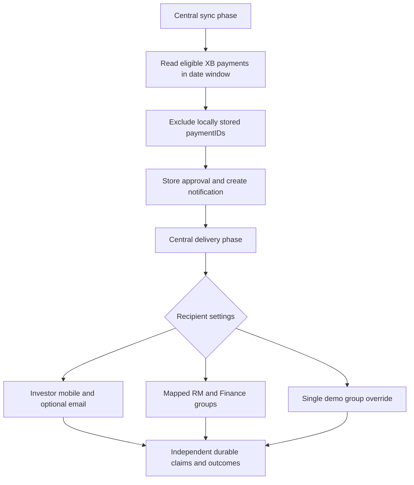

# Deposit approval design

## Requirements

- Preserve request notifications in RECEIPTVA and RECEIPTREQ.
- Add DEPOSIT_APPROVE for approved deposits from XBpoolPromise.
- Identify source transactions by paymentID, not investor code, amount or date.
- Apply PaymentTypeID=1, exclude PayModeID 4 and 8, and use the EOD-derived business date.
- Store source data locally and deliver only pending recipient/channel outcomes.
- Support configurable investor mobile order/email and independent optional RM/Finance groups or one demo group.
- Preserve durable accepted, sent and uncertain delivery states across restart or multiple workers.

## Flow

Groups use the reusable Deposit Requisition channel and job logic with messageType=DEPOSIT_APPROVE. The existing default message type remains RECEIPTREQ. Source sync, tables, ledger namespace, templates, flags and audit type are separate. This avoids mixing request and approval outcomes.

## Failure handling

| Failure | Result |
| --- | --- |
| Local sync insert fails | Other rows continue; next source scan can retry the missing paymentID |
| Two workers insert the same payment | Unique SourcePaymentID and a locked existence check protect storage |
| Accepted provider send, DB flag update fails | Existing delivery ledger prevents an automatic duplicate and supports reconciliation |
| Provider timeout or ambiguous response | UNKNOWN; no automatic fallback/resend |
| Confirmed WhatsApp rejection | Try SMS when enabled |
| Investor or one group fails | Other recipient deliveries continue independently |
| Missing/conflicting RM group | Skip that RM group; investor/Finance remain eligible |
| Module disabled | Request modules continue; approval tables/history remain intact |

## Limits

PaymentDate is the supplied business date and is not proof of the exact approval time. No new system timestamp is substituted in the message. The source table's presence/filter combination is assumed to represent approval. Reversals and corrections after an already-notified payment are not new events; they require a separate business rule/module. Newly enabled real groups may receive eligible backlog; choose their cutoffs deliberately.

A continuously rescanned date window trades extra source reads for recovery without a fragile maximum-ID cursor. Benchmark the selected window in UAT. A true durable source change feed would be an alternative for high volumes.
