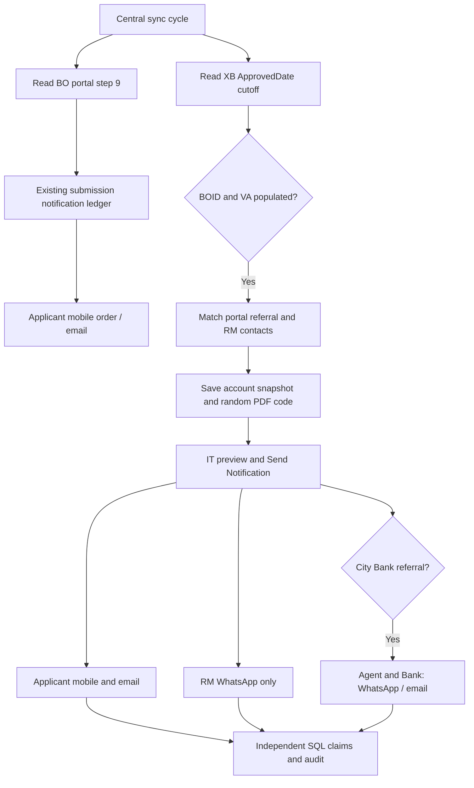

# BO workflow design

Submission messages keep the original ledger key. Account messages use module BO_ACCOUNT, NotificationID, role and MOBILE/EMAIL as the delivery identity. Discovery only inserts or refreshes account snapshots; it never sends account-opening messages.

Ready source rows require populated BOID and VA. The preview validates the 13-digit VA, current cutoff, destination contacts and PDF readiness. Each message is either eligible or Needs attention. A missing agent blocks Agent and Bank together. A missing PDF blocks applicant messages without blocking the independent RM alert.

A hash of snapshot, templates and account settings prevents dispatch against a stale preview. Dispatch freezes the snapshot and a single send-time value. Known failed outcomes can be explicitly retried; unknown outcomes require reconciliation. The same bearer PDF code is preserved on repeated discovery. Ledger acceptance is persisted separately from audit.

The existing CityAgent sender must be off. Legacy recipient ledger states are read before account sends to prevent known duplicate agent/bank deliveries. Historical flag-only sends and separate external senders must be reviewed before activation.

No source database is written. The only new application table is BOAccountNotification in poolPromise. Source reads and inserts are parameterized. Generated acknowledgement filenames are restricted to InvestorCode characters and cannot escape the configured directory.
